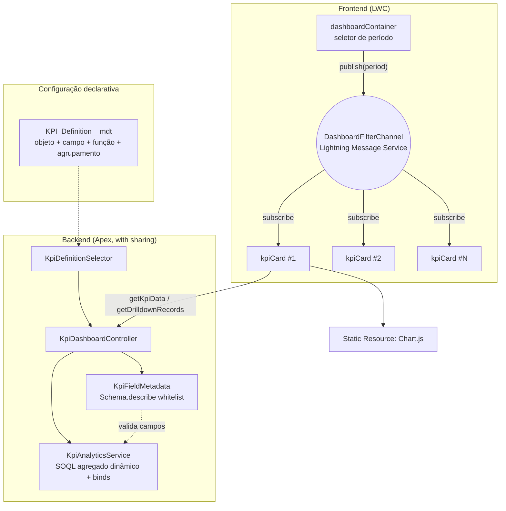

# Sales Dashboard

Painel de vendas em Lightning Web Components em que cada KPI é configuração, não código: objeto, campo, função de agregação e agrupamento vêm de Custom Metadata. Adicionar um indicador novo não exige alterar Apex nem LWC.

[](https://github.com/witorlomazzi/sales-dashboard/actions/workflows/ci.yml)

> Projeto demonstrativo, com empresa e dados fictícios. Experiências profissionais reais não são publicadas por confidencialidade.

**Demo no navegador:** [salesforce.flupdigital.com.br/#demo-dashboard](https://salesforce.flupdigital.com.br/#demo-dashboard)

## O problema

Painéis de vendas costumam virar um componente fixo por métrica. Trocar o campo de agrupamento ou usar `ARR__c` no lugar de `Amount` vira tarefa de desenvolvimento, com deploy e teste para uma mudança que é só de negócio.

## A solução

Cada KPI é um registro de `KPI_Definition__mdt`. O motor valida a definição contra o schema do objeto e só então monta a consulta agregada. O container publica o período escolhido e cada card se atualiza sozinho, com drilldown por clique no gráfico.

KPIs de exemplo incluídos:

- **Pipeline por estágio:** soma de `Amount` agrupada por `StageName`, em barras.
- **Quantidade de oportunidades por estágio:** contagem, em rosca.
- **Valor ganho por proprietário:** soma de `Amount` agrupada por `OwnerId`, com o nome resolvido pelo describe do campo de referência.

## Arquitetura



## Decisões técnicas

| Decisão                                           | Por quê                                                                                                         | Custo da escolha                                        |
| ------------------------------------------------- | --------------------------------------------------------------------------------------------------------------- | ------------------------------------------------------- |
| KPI como Custom Metadata                          | Indicador novo sem deploy de código                                                                             | A definição precisa ser validada em runtime             |
| Lightning Message Service entre container e cards | Os cards são irmãos na árvore; um consumidor novo do filtro não exige tocar no container                        | Mais uma peça de metadata (o canal)                     |
| Validação por `Schema.describe` antes da consulta | Objeto e campos vêm de configuração e mesmo assim são conferidos                                                | Uma chamada de describe por KPI                         |
| `if/else` explícito no bind do drilldown          | O operador ternário unificava os tipos em `Id` na compilação e quebrava valores como `"Prospecting"` em runtime | Código um pouco mais longo, com a armadilha documentada |
| Chart.js em Static Resource                       | Sem dependência externa em runtime (compatível com CSP)                                                         | Atualizar a biblioteca exige trocar o resource          |

## Segurança

1. Objeto, campo de agregação, agrupamento e campo de data vêm de Custom Metadata mantido pelo admin, não de entrada livre do usuário.
2. Antes de qualquer SOQL, `KpiFieldMetadata.resolve()` confere via `Schema.describe`: o objeto existe e é consultável, o agrupamento é agrupável, o campo agregado é numérico (quando a função não é `COUNT`) e o campo de data é `Date` ou `DateTime`.
3. A única entrada do usuário, o período em dias, entra sempre por bind.
4. A consulta roda com `AccessLevel.USER_MODE`: CRUD e FLS do usuário valem de ponta a ponta.

## Testes

- **Apex:** 23 métodos de teste. Cobrem validação por describe (objeto ou campo desconhecido, campo não numérico, data inválida), agregação com rótulos de picklist e de referência, filtro de período, drilldown por grupo e lote de 200 registros.
- **Jest:** 7 testes do `dashboardContainer` (definições, publicação do período, erro) e do `kpiCard` (carregamento, inscrição no canal, erro, drilldown por clique).
- **CI:** o GitHub Actions roda o Jest e o Salesforce Code Analyzer (PMD) em cada push e pull request. O deploy de validação com testes Apex roda quando o repositório tem uma org de CI configurada.

```bash
npm install --legacy-peer-deps
npm run test:unit
sf apex run test --test-level RunLocalTests --code-coverage --wait 20
```

## Como rodar

```bash
sf org login web --alias devhub --set-default-dev-hub
sf org create scratch --definition-file config/project-scratch-def.json --alias dashboard-scratch --set-default
sf project deploy start
sf apex run --file scripts/apex/setup-dashboard-demo.apex
```

Depois, adicione o componente **Sales Dashboard** a uma App Page no Lightning App Builder. Em uma Developer Edition, pule a criação da scratch org e use `-o <sua-org>` nos comandos.

## Por onde começar a ler o código

| Arquivo                                                  | O que observar                                       |
| -------------------------------------------------------- | ---------------------------------------------------- |
| `force-app/main/default/classes/KpiFieldMetadata.cls`    | Validação da definição contra o schema               |
| `force-app/main/default/classes/KpiAnalyticsService.cls` | SOQL agregado dinâmico, rótulos de grupo e drilldown |
| `force-app/main/default/lwc/kpiCard/`                    | Inscrição no canal de mensagens e gráfico            |
| `force-app/main/default/lwc/dashboardContainer/`         | Publicação do período                                |

## Limitações e próximos passos

- Um KPI agrega um objeto por vez; indicadores que cruzam objetos exigiriam outro tipo de definição.
- O tipo de gráfico da definição é repassado ao Chart.js, mas só barras e rosca têm estilo ajustado no `kpiCard`.

## Licença

MIT. Chart.js (MIT).
