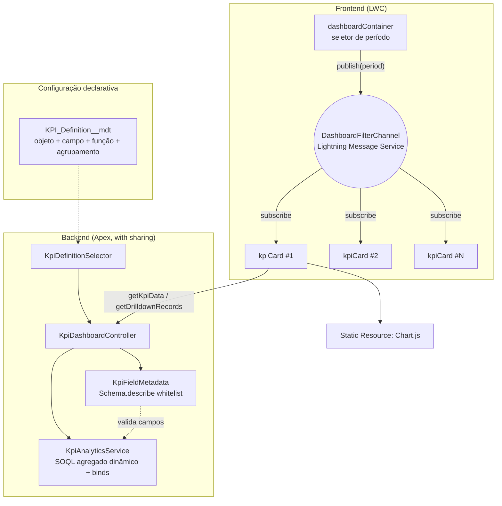

# Sales Dashboard — Painel Analítico de KPIs Configuráveis

Dashboard de vendas construído inteiramente com Lightning Web Components: KPIs (gráficos, métricas, agrupamentos) são definidos via Custom Metadata, não hardcoded no código. Adicionar um KPI novo (qualquer objeto, qualquer campo numérico, qualquer agrupamento) não exige uma linha de Apex ou LWC a mais.

## O problema de negócio

Painéis de vendas costumam virar um emaranhado de componentes hardcoded para cada métrica específica: mudar o campo de agrupamento ou trocar `Amount` por `ARR__c` vira uma tarefa de desenvolvimento. Este projeto trata cada KPI como dado de configuração (`KPI_Definition__mdt`), validado dinamicamente contra o schema do objeto antes de qualquer consulta.

## Arquitetura



### Por que Lightning Message Service, e não um evento pai→filho

`dashboardContainer` e os `kpiCard` são **irmãos** na árvore de componentes (cada card é renderizado dentro de um `for:each`, não recebe eventos do pai diretamente). Em vez do container "alcançar" cada card via `querySelector` e chamar um método `@api`, o container só **publica** o período selecionado no canal `DashboardFilterChannel`, e cada `kpiCard` se **inscreve** por conta própria. Isso significa que adicionar um novo consumidor do filtro (uma segunda página de dashboard, por exemplo) não exige tocar no container.

## Segurança do SOQL dinâmico agregado

Mesmo modelo de segurança do projeto Opportunity Map, aplicado a agregações:

1. Nome do objeto, campo de agregação, campo de agrupamento e campo de data vêm de **Custom Metadata configurado por admin** (dado confiável, não input de usuário livre).
2. Antes de montar qualquer SOQL, `KpiFieldMetadata.resolve()` valida via `Schema.describe`: o objeto existe e é consultável, o campo de agrupamento é agrupável, o campo de agregação é numérico (quando a função não é `COUNT`), o campo de data é `Date`/`DateTime`.
3. O único input de usuário real — o período em dias — entra sempre via **bind variable**.
4. A consulta roda com `AccessLevel.USER_MODE`, então CRUD/FLS do usuário é respeitado de ponta a ponta.
5. Uma pegadinha real encontrada durante o desenvolvimento: usar um operador ternário para decidir se o valor de bind do drilldown deveria ser `Id` ou `String` fazia o Apex **unificar os tipos em tempo de compilação** e forçar a conversão para `Id` mesmo no branch de `String`, quebrando em tempo de execução para valores como `"Prospecting"`. A correção foi trocar por `if/else` explícito — documentado no código.

## Instalação em Scratch Org

```bash
sf org login web --alias devhub --set-default-dev-hub
sf org create scratch --definition-file config/project-scratch-def.json --alias dashboard-scratch --set-default
sf project deploy start
sf apex run --file scripts/apex/setup-dashboard-demo.apex
```

Depois, adicione o componente **Sales Dashboard** a uma App Page no Lightning App Builder.

## KPIs de exemplo incluídos

- **Pipeline por Estágio** (SUM de `Amount`, agrupado por `StageName`, gráfico de barras)
- **Quantidade de Oportunidades por Estágio** (COUNT, gráfico de rosca)
- **Valor Ganho por Proprietário** (SUM de `Amount`, agrupado por `OwnerId`, com resolução automática de nome via describe de campo de referência)

## Testes

20 testes Apex (100% de aprovação) cobrindo: validação de describe (objeto/campo desconhecido, campo não numérico, campo de data inválido), agregação com rótulos de picklist e de referência (Owner), filtro de período, drilldown por grupo (incluindo o caso de referência convertido para `Id`), e bulk de 200 registros. 7 testes Jest cobrindo o `dashboardContainer` (definições, publicação de período, erro) e o `kpiCard` (carregamento, inscrição no canal de mensagem, erro, drilldown por clique no gráfico).

```bash
npm install --legacy-peer-deps
npm run test:unit
sf apex run test --tests KpiAnalyticsServiceTest --tests KpiFieldMetadataTest --tests KpiDashboardControllerTest --code-coverage --wait 20
```

## Demonstração

> _Placeholder: adicionar GIF do dashboard com troca de período e drilldown por clique no gráfico._

## Licença

MIT — Chart.js (MIT).
